# Armillary

[](https://github.com/draarivpatel-ui/armillary/releases/tag/v0.1.0)

**[Watch the full demo video](https://github.com/draarivpatel-ui/armillary/releases/tag/v0.1.0)**


Every AI agent you use, in one observatory.

Armillary is a Mac app that finds the AI coding agents on your computer, gathers the session history each one already keeps into one private archive on that Mac, and shows it back to you: what is running now, what happened on any day, any past session read as a document, and one search across all of them.

Armillary is a working name. This is an early release (version 0.1.0): macOS only, and builds are unsigned (see [Install](#install)). Everything in the screenshots is invented sample data.

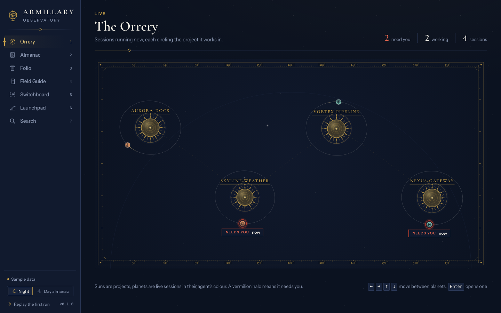

## Who it is for

People who use more than one coding agent (for example Claude Code plus Codex plus Gemini CLI plus a niche one) and find their history scattered across a dozen folders and formats. Each agent keeps its own record in its own way; there is no single place to see them, search them, or tell which one is waiting for you.

## Features

Seven views, named like the parts of an observatory:

| View | What it is |
|---|---|
| **Orrery** | The live view. Each project is a sun, each running agent session is a planet circling it. A session that needs you swings to the front with a red halo and a "needs you" label. Arrow keys move between planets, Enter opens one. |
| **Almanac** | History by day. Each day lists its sessions grouped by project, with the agent, duration, turns and files touched. Filter by agent, project, date, status and model. |
| **Folio** | One session read as a parchment document rather than a log: your prompts as headings, replies as text, tool calls and file edits as margin notes with expandable diffs, plans as checklists, errors flagged, token use in the footer. Export to Markdown or HTML is planned (switched off in 0.1.0). |
| **Field Guide** | An illustrated entry for each of the **80 agents** in the built-in catalogue, niche ones included: whether it is installed, where its data lives on this Mac, how much Armillary can do with it, and a link to its docs. |
| **Switchboard** | Each agent's MCP servers and rules files (AGENTS.md, CLAUDE.md, GEMINI.md, Cursor rules and others) side by side, differences highlighted. Read-only in 0.1: it never changes a file. Key-looking values are masked. |
| **Launchpad** | Start an installed command-line agent, or a plain shell, in an embedded terminal inside one of your projects. |
| **Search** | One box across every imported session (SQLite full-text search): prompts, replies, tool names and file paths, filtered by agent, project and date. A hit opens in the Folio. |

There are two themes (night, and a light "Day almanac") and a **first run**: an opening of about half a minute in which an armillary sphere assembles ring by ring, a plaque asks your permission, each agent it finds ignites as a star as its history imports, the stars form constellations named for your projects, and the view hands over to the Orrery. It is driven by the real detection and import, not a timer. You can replay it from the rail, skip it with Escape, and it has a reduced-motion version.

### Which agents are supported

The catalogue has **80** built-in entries (the number of files in `crates/adapters/src/builtins`; the app reads the count from the registry). They are not all equal, and the Field Guide shows a coverage level for each (detect, history, live, config):

- **22 agents have a history importer**: Aider, Amp, Antigravity CLI, Claude Code, Cline, Continue, Crush, Cursor CLI, Factory Droid, Gemini CLI, GitHub Copilot CLI, Goose, Hermes Agent CLI, iFlow CLI, Kilo Code, Kimi Code CLI, Open Interpreter, OpenAI Codex CLI, OpenCode, Qoder CLI, Qwen Code, Roo Code.
- The rest are detected (found installed, with their data folder shown) but their history is not imported.
- The importers were built and tested against synthetic data laid out as each agent's files are laid out. That establishes how the parsers behave, not that they match the current release of each agent. Claude Code and Codex CLI are the two reference importers. Known gaps are listed in [demo/dataset/README.md](demo/dataset/README.md) ("Adapter limits found while building this").
- The "needs you" state appears only when an agent writes a native waiting signal (for example a permission prompt); a quiet process is shown as unknown, never guessed.

## Privacy

Armillary keeps everything local. There is no cloud component.

- **Nothing is read until you say yes.** The first screen is a consent plaque that lists what Armillary reads and what it never does. If you choose "Not now", the core refuses every command that would read your agent folders, and on a fresh install the app stays empty. Declining later, or choosing Delete archive and reset, stops the background watcher, the live detector and any import: a file already being read finishes and nothing new is read. Sessions already imported stay in the archive until you use Delete archive and reset.
- **What it reads:** the session histories your agents already keep, their settings, rules and MCP config files, which agents are installed (it looks for their apps and commands, and does not launch them), and the list of running agent processes for the live view. It looks only in the folders each agent keeps on your Mac.
- **What it never does:** open credential files, keys or tokens (also when a link points at one); follow a link out of an agent's folder or project; change your agents' files; send anything off your Mac.
- **Where your data goes:** into one SQLite archive file in the app's own data folder, readable only by your user account. It is a plain, unencrypted copy of what was imported, so treat it like the originals. The archive keeps its copy of a transcript after an agent deletes its own file, until you delete the archive.
- **No network, no telemetry.** The app makes no network requests of its own, has no analytics and no update check, and its content security policy blocks connections other than to itself. The two things that can touch the network are links you click (the Field Guide's Docs links) and agents you launch yourself from the Launchpad, which run under their own rules.
- **Size limit:** each history file is read whole and skipped if it is over 64 MiB or holds more than 250,000 records; the Field Guide shows "Skipped, too large" with the file's name.

Caveats, sources and the exact list of files: [PRIVACY.md](PRIVACY.md). Two to know now: the credential protection works by file name and safe file reading, so a secret pasted inside an ordinary transcript is still copied into the archive; and the app has been exercised end to end on a synthetic home folder, not on a large set of real agent folders. It has not had an external security audit.

### Removing your data

- **In the app:** **Delete archive and reset** in the rail. After you confirm, it stops background reading, deletes the archive (`armillary-archive.sqlite3` with its `-wal` and `-shm` files, and any `.bak-<time>` copies that "Move it aside" kept), the first-run choice and leftover import snapshots, clears the app's local storage and shows the first-run screen again. Your agents' own files are not touched.
- **By hand:** quit the app and delete `~/Library/Application Support/com.armillary.app` (the bundle identifier is `com.armillary.app`). macOS may also keep web storage and caches under `~/Library/WebKit/com.armillary.app` and `~/Library/Caches/com.armillary.app`.

## Requirements

- macOS (the only supported platform in 0.1; Windows history reads fail closed by design, and Linux is untested).
- To build from source: a recent stable Rust toolchain (with `cargo` on your PATH, from [rustup.rs](https://rustup.rs)), Node.js with npm, and the Xcode command line tools.

## Install

There is no signed or downloadable release yet. Build it yourself (next section). The result is an **unsigned** `Armillary.app` of about 16 MB, not signed with an Apple Developer ID and not notarized, so macOS will refuse to open it on the first try. These are the standard macOS steps for an unsigned app you built or trust:

1. Move `Armillary.app` into Applications and double-click it. macOS says it cannot verify the app. Click Done (or Cancel), not "Move to Bin".
2. Open **System Settings, Privacy and Security**, scroll to the Security section, and click **Open Anyway** next to the Armillary message. Enter your password or use Touch ID.
3. Open the app again and click **Open** on the final prompt. After that it opens normally.

An app you built yourself can also have its quarantine flag removed with `xattr -dr com.apple.quarantine /Applications/Armillary.app`. These steps follow standard macOS behaviour and were not re-run for this README.

## Build and run

```sh
npm install                        # from the repo root: installs app, design and the ui packages (npm workspaces)
tools/build-release.sh [out-dir]   # frontend, release binary and the .app bundle; copies Armillary.app to out-dir (default ./build)
```

- `cargo` downloads the Rust crates as needed. If you already have them in your local cargo cache and want to build without network access, run the script with `ARMILLARY_OFFLINE=1`. `tools/test-all.sh` and `tools/capture-app/run.sh` honour the same switch.
- The script's header explains why it runs the three build steps by hand instead of `tauri build` (the pinned CLI, 2.2.2, adds a feature that needs a crate that was not available offline when it was written). It makes no DMG, does not sign and does not notarize. The script was developed and run offline against a warm cargo cache; the default online path and a build from a completely clean machine have not been tried.
- **Development:** `cd app && npm run dev` serves the interface in a browser at `http://localhost:5173` with built-in sample data; add `?presentation=1` for the full presentation snapshot. `npm run tauri:dev` is the Tauri development entry; it has not been verified and may hit the same pinned-CLI problem.
- Never point a run, capture or test at your real home folder unless you mean to. The demo tooling uses an invented home folder (`demo/dataset/generate.py`) and sets `HOME` to it.

### Layout

`app/` the Tauri v2 + React 19 app; `design/` the "Observatory" design system; `crates/` Rust (`model` the shared contract and generated types, `adapters` the agent importers and detection, `archive` the SQLite archive and search); `ui/` the standalone `orrery`, `folio` and `firstrun` view libraries; `demo/` the synthetic dataset and presentation snapshot; `fixtures/` synthetic agent data only (including decoy credential files that tests assert are never read); `tools/` build and test scripts; `docs/screenshots/` the images below. The design contract is [SPEC.md](SPEC.md); the shared data contract is [crates/model/CONTRACT.md](crates/model/CONTRACT.md).

## Tests

```sh
tools/test-all.sh        # every suite, one total
```

This runs the Rust workspace (`crates/*`), the Tauri app crate (`app/src-tauri`) and vitest in `app`, `design`, `ui/orrery`, `ui/folio` and `ui/firstrun`. Passing tests do not certify the whole app; SPEC.md section 6 says so plainly.

## Screenshots

All on the synthetic sample dataset (an invented developer, invented projects). Dark first, then light.

| | Dark | Light |
|---|---|---|
| Orrery |  | 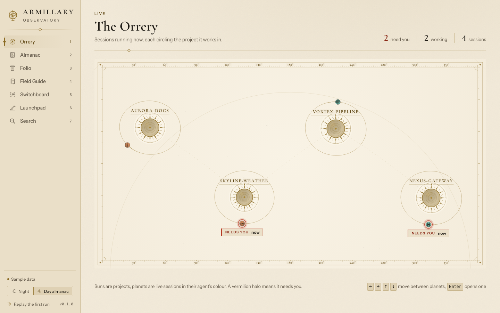 |
| Almanac | 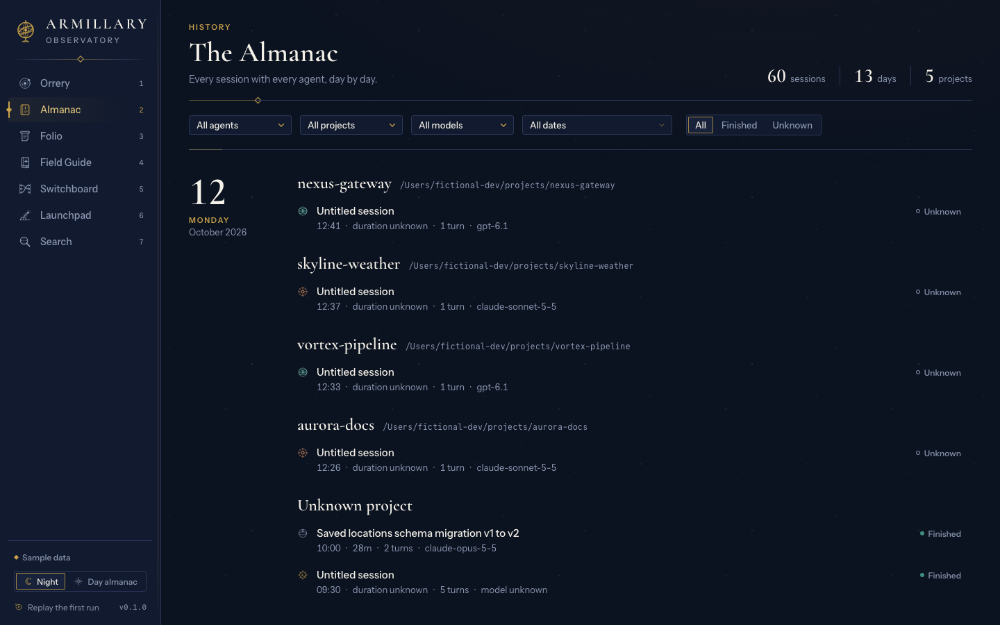 | 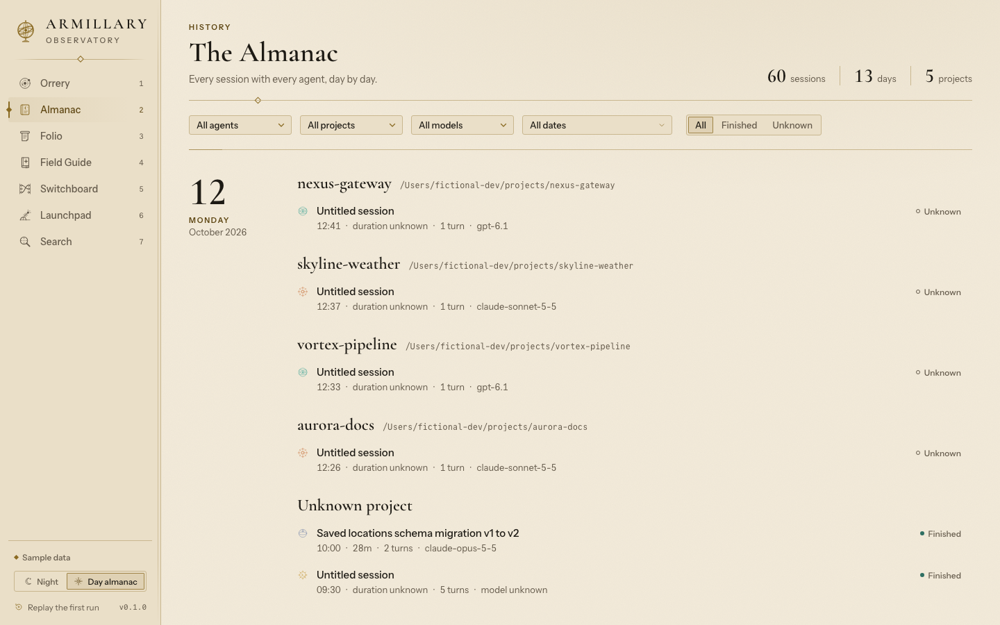 |
| Folio | 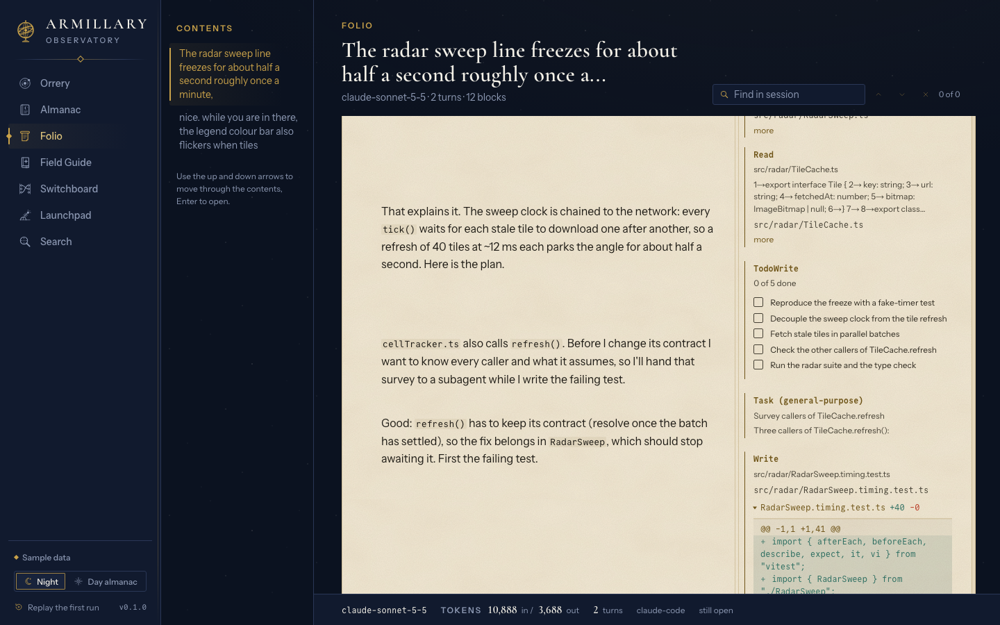 | 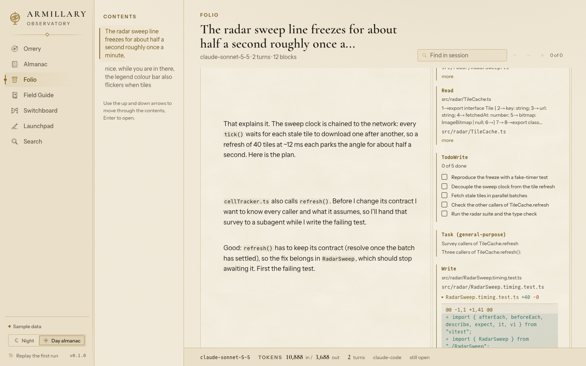 |
| Field Guide | 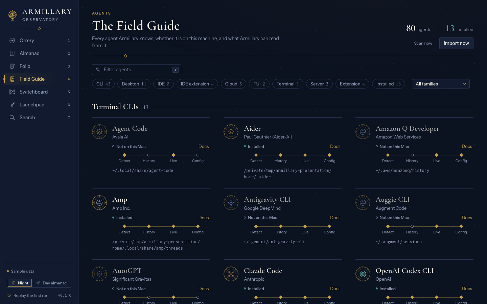 | 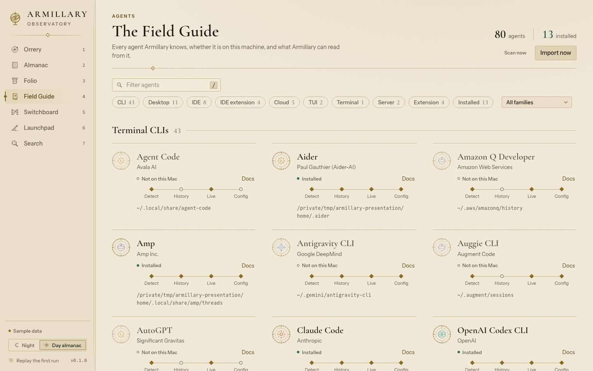 |
| Switchboard | 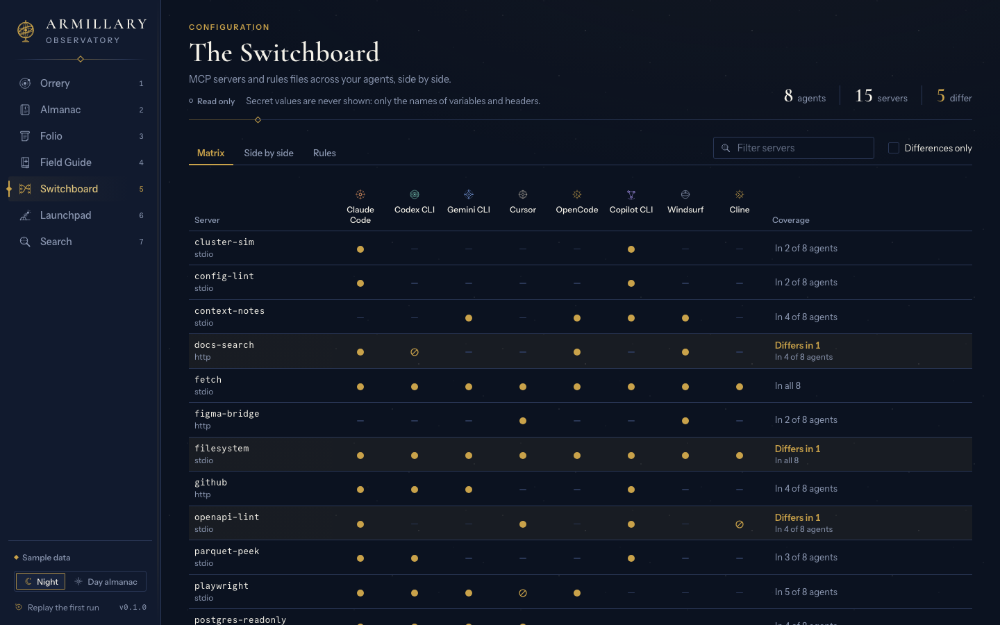 | 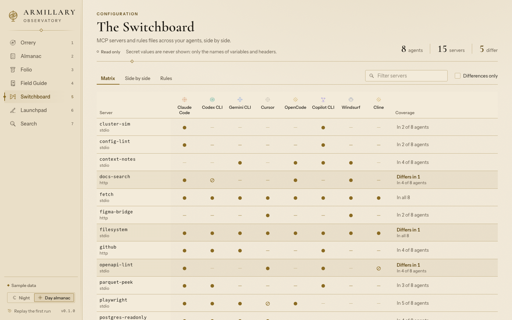 |
| Launchpad | 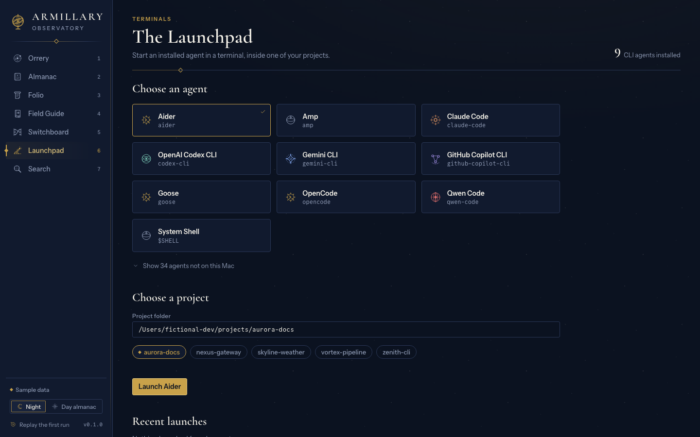 | 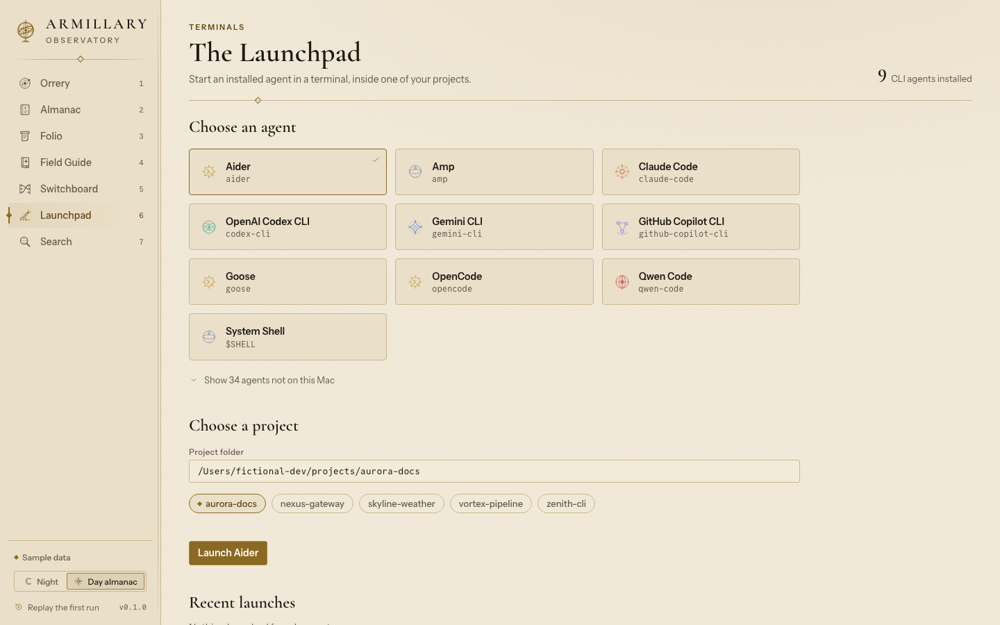 |
| Search | 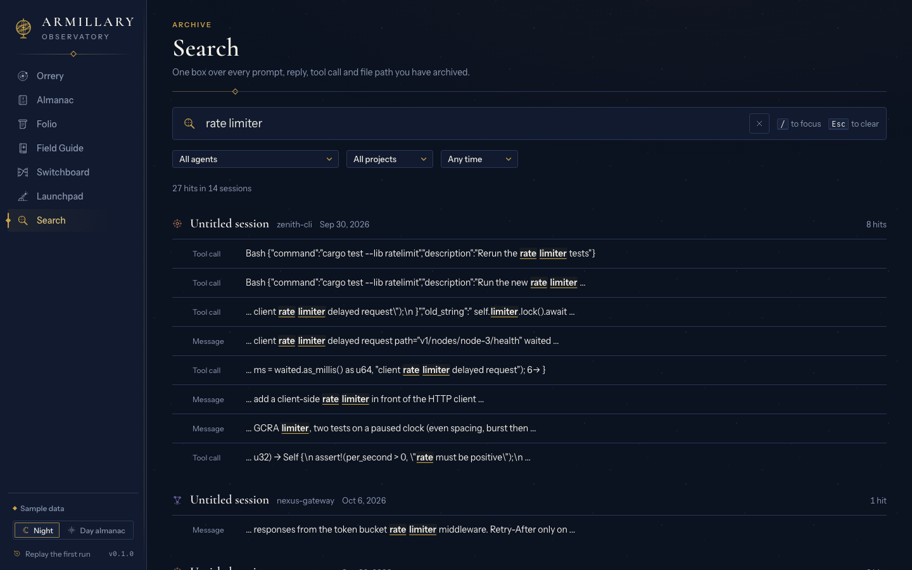 | 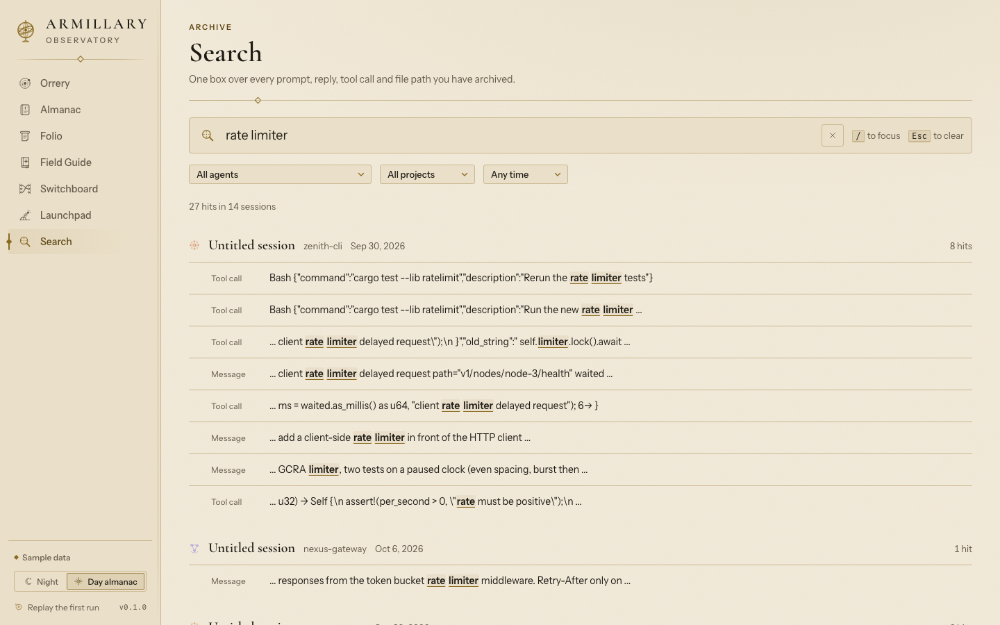 |

## Status

Early. Version 0.1.0, macOS only, unsigned builds, no export yet, Switchboard is read-only. See [RELEASE-NOTES.md](RELEASE-NOTES.md) for the full list of known limits.

## License

MIT, see [LICENSE](LICENSE). The bundled fonts (Cormorant Garamond, Instrument Sans, Commit Mono) are under the SIL Open Font License; their licence texts are in `design/fonts/` and their sources and checksums are in `design/FONTS.md`.
